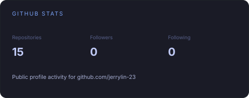
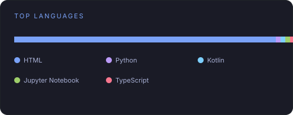
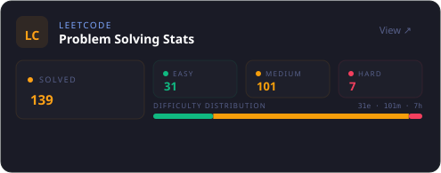

### CS + Business Double Degree @ Waterloo & Laurier
**Building cloud services, market data systems, and AI developer tools**

📍 Toronto, Ontario, Canada

---

## 📊 Statistics Dashboard

<table>
  <tr>
    <td width="50%" align="center">
      
    </td>
    <td width="50%" align="center">
      
    </td>
  </tr>
  <tr>
    <td width="50%" align="center">
      
    </td>
    <td width="50%" align="center">
      
    </td>
  </tr>
</table>

---

## 👋 About Me
I study **Computer Science at the University of Waterloo** and **Business Administration at Wilfrid Laurier University**. I work as a **Software Engineer Intern at RBC Wealth Management**, building cloud services and data-access tools for AI agents. My projects include streaming market data systems, AI code review tools, and LLM fine-tuning.

* 🏦 **Current work:** AWS and OpenShift services, REST and GraphQL APIs, and a migration to official Snowflake SDKs.
* 🔭 **Recent project:** Prediction Markets Order Flow, with a C++20 order-book engine and durable market data capture.
* 🔍 **Seeking:** SWE / ML Engineer Co-op opportunities for **Winter 2027**.

---

## 🛠️ Technical Skills

<b>💻 Languages & Core Dev</b>

  
  
  
  
  
  
  
  

<b>🤖 Machine Learning & AI</b>

  
  
  
  
  
  
  

<b>🌐 Frameworks & Platforms</b>

  
  
  
  
  
  
  
  
  

<b>⚙️ Cloud, Data & DevOps</b>

  
  
  
  
  
  
  
  
  
  
  
  
  

---

## 🚀 Featured Projects

### 📡 [Prediction Markets Order Flow](https://github.com/jerrylin-23/pm-data-platform)
    
* **Order-book engine:** Reached **234K updates/s** at **1,000 levels per side**, **12×** the Python dictionary reference throughput in a local benchmark.
* **Live capture:** Observed **127 book states/s** across **8 Polymarket markets** and **16 books** in a live capture run.
* **Data pipeline:** Built durable SQLite capture, transactional Kafka workers, sequence-gap recovery, and a FastAPI/React dashboard.

### 🔀 [MCP Handoff Portal (Tokenmaxxing)](https://github.com/jerrylin-23/tokenmaxxing)
    
* **Plan to code:** Built a desktop tool that turns ChatGPT Web research and planning into structured Markdown handoff files for Codex CLI.
* **Workspace access:** Exposed Git state and files through **5 FastMCP tools** over Tailscale Funnel, scoped to one granted workspace.
* **Execution controls:** Added permission checks on every call, path-traversal blocking, and single-use local approvals tied to SHA-256 plan hashes.

### 🧠 [DeepSeek LeetCode Fine-Tuning](https://github.com/jerrylin-23/DeepSeek-LeetCode-Oriented-Training)
    
* **Model training:** Fine-tuned DeepSeek-Coder **6.7B** on **2,400** curated problems via QLoRA.
* **Evaluation:** Increased pass@1 from **24% to 34%** on a fixed **100-problem** execution benchmark; hard-problem pass@1 reached **28.6%**.
* **Local Deployment:** Built an evaluation harness with sandboxed execution, merged LoRA adapters, and exported to GGUF for local Ollama inference.

### 🤖 [Agentic GitHub PR Reviewer](https://github.com/jerrylin-23/gh-pr-reviewer)
    
* **Parallel review:** Cut review time **2.2×** with **3 AI agents** reviewing in parallel and a moderator that checks findings against the diff, filters false positives, and merges duplicates.
* **Desktop interface:** Built an Electron macOS app with React and TypeScript, showing findings by severity beside code diffs.
* **Review controls:** Added Python thread-pool fallbacks for agent or moderator failures and human approval before GitHub CLI posts comments.

### 📈 [Alpha Radar](https://alpha-radar-b725ddaf6ce0.herokuapp.com/)
   
* **Market scanner:** Built a pandas and NumPy scanner over **500+** S&P 500 and Nasdaq 100 tickers using yfinance data to detect fair value gaps and equal highs and lows.
* **Historical simulation:** Recorded a **74% simulated win rate** across **700+** historical setups on NVDA, GOOGL, and AAPL.
* **Dashboard:** Deployed a React/TypeScript interface with TradingView charts and WebSocket updates through a Flask API.

### 📱 [IntelliCal](https://github.com/jerrylin-23/IntelliCal)
   
* **Team delivery:** Led sprint planning for a **4-person team** across **4 sprints**, building a Kotlin Android app with Jetpack Compose, Gemini meal analysis, and Supabase authentication.
* **Meal analysis:** Reduced response variability by **40%** on repeated meal photos through Gemini temperature tuning, JSON-mode responses, and client-side retries.
* **Meal logging:** Reduced logging time by **20 seconds per entry** versus manual input, with structured calorie and macro fields, persistent sessions, and real-time sync.

[Watch the demo](https://www.youtube.com/shorts/UCFAg8bHJJc)

---

## 💼 Professional Experience

### 🏦 Software Engineer Intern @ RBC Wealth Management
*Toronto, ON · Sept 2026 to Present*

* **Service performance:** Reduced p95 latency by **70%** during peak load for AWS and OpenShift wealth services through autoscaling, load balancing, and Redis rate limiting shared across clusters.
* **AI data access:** Built CRM tools serving **30,000+ requests/day** through REST and Apollo GraphQL APIs in Node.js and TypeScript, with Redis-cached authentication tokens.
* **Platform maintenance:** Leading the migration of custom Snowflake integrations to official Snowflake SDKs.

### 🚘 Software Engineer Intern @ AutoTrader.ca
*Toronto, ON · Jan 2025 to Apr 2025; Sept 2025 to Dec 2025*

* **Data pipelines:** Cut Python pipeline runtime from **4 hours to under 15 minutes** for **500K+ listings** on AWS through parallel workers and Redis caching.
* **Service reliability:** Cut failed-request investigation time by **26%** with correlated JSON logs, exponential-backoff retries, and circuit breakers.
* **Reporting:** Replaced manual weekly reporting for **20+ product stakeholders** with Python ETL, PostgreSQL, and Tableau dashboards.
* **Content scoring:** Ranked opportunities across **20K+ articles** using scikit-learn regression and cohort analysis.

### 🎟️ Software Engineer Intern @ HeadsUp Group & iVirtual
*Toronto, ON · Jan 2024 to Apr 2024*

* **Data consolidation:** Saved **300+ engineering hours/year** by combining **4 databases** into one AWS data layer with automated sync across Dockerized Python and Node.js services.
* **User engagement:** Increased active users by **40%** in a Seattle Kraken NHL rewards pilot with **200+ users** through a SendGrid notification platform with templates for each user segment.

---

## 📈 Contribution Graph

  

---

## 📫 Let's Connect!

  
  
  

<!-- Keywords: Machine Learning Engineer · LLM Fine-Tuning · QLoRA · PyTorch · AI Agents · Full-Stack Developer · Python · TypeScript · React · Next.js · FastAPI · Data Engineering · AWS · Docker · Quantitative Finance · SWE Co-op Winter 2027 -->
